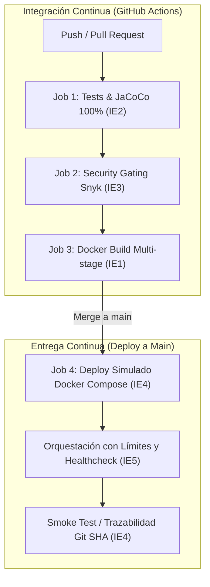

# Delivery Service — Microservicio FoodGo (Caso 05)
## Evaluación Parcial N°2 — Ingeniería DevOps (DOY0101)

Este repositorio contiene la implementación y automatización del ciclo de vida continuo (CI/CD) para el microservicio **Delivery Service** (`delivery-svc`), perteneciente a la plataforma de entrega de pedidos FoodGo. El proyecto cumple rigurosamente con los 5 Indicadores de Evaluación (IE1 a IE5) exigidos en la pauta de evaluación.

---

## 1. Arquitectura y Tecnologías del Microservicio

| Dimensión | Especificación Técnica |
| :--- | :--- |
| **Asignatura** | DOY0101 — Ingeniería DevOps |
| **Stack Principal** | Java 21 LTS · Spring Boot 3.3.5 · Spring Data JPA · Maven |
| **Base de Datos** | H2 Database en memoria (Aislamiento por dominio DDD) |
| **Documentación API** | OpenAPI 3.0 / Swagger UI (`/swagger-ui.html` y `/v3/api-docs`) |
| **Estrategia de Pruebas** | JUnit 5 + Cucumber BDD + Cobertura JaCoCo (Exigencia 100% de líneas) |
| **Seguridad y SCA** | Dependabot + Snyk SCA & SAST con Quality Gate estricto |
| **Contenedores y Orquestación** | Docker Multi-stage (Alpine JRE, Non-Root) + Docker Compose v2 |
| **CI/CD** | GitHub Actions Pipeline con despliegue continuo simulado y trazabilidad |

---

## 2. Mapa de Cumplimiento de Indicadores de Evaluación (Rúbrica 100%)



| Indicador | Ponderación | Mecanismo de Implementación | Ubicación en el Repositorio |
| :--- | :--- | :--- | :--- |
| **IE1: Contenedores** | 20% | Dockerfile multi-stage, imagen base ligera Alpine, usuario no root y build automatizado en CI. | [`Dockerfile`](Dockerfile), `.github/workflows/pipeline.yml` |
| **IE2: Pruebas Automatizadas** | 20% | Suite completa JUnit + Cucumber BDD y validación estricta de cobertura JaCoCo al 100%. | `src/test/`, `pom.xml`, `.github/workflows/pipeline.yml` |
| **IE3: Seguridad y Escalabilidad** | 20% | Dependabot semanal, análisis de vulnerabilidades Snyk con bloqueo ante severidad Alta/Crítica, y definición de cuotas de recursos. | `.github/dependabot.yml`, `docker-compose.yml`, `pipeline.yml` |
| **IE4: Despliegue y Trazabilidad** | 20% | Despliegue automático condicionado en entorno simulado, verificación de salud vía curl, etiquetado con SHA del commit. | `.github/workflows/pipeline.yml` |
| **IE5: Orquestación** | 20% | Docker Compose con especificación de recursos (CPU y RAM), política de reinicio, healthcheck y capacidad de réplicas. | [`docker-compose.yml`](docker-compose.yml) |

---

## 3. Detalle de Implementación Técnica por Indicador

### IE1 — Contenedorización Eficaz y Optimizada (`Dockerfile`)
- **Construcción Multi-Stage**: Se separa la fase de compilación (`maven:3.9-eclipse-temurin-21-alpine`) de la fase final de ejecución (`eclipse-temurin:21-jre-alpine`). Esto reduce drásticamente el peso de la imagen al eliminar compiladores, librerías innecesarias y código fuente.
- **Principio de Menor Privilegio (Non-Root User)**: Se crea el usuario del sistema `appuser` con grupo `appgroup`, evitando vulnerabilidades de escalamiento de privilegios dentro del contenedor.
- **Monitoreo Nativo (`HEALTHCHECK`)**: Se incorpora sondeo periódico mediante `wget` al endpoint funcional `/api/entregas`.
- **Higiene de Contexto**: Se añade [`.dockerignore`](.dockerignore) para excluir directorios locales pesados como `target/`, carpetas de IDE (`.idea`, `.vscode`) y metadatos de Git.

### IE2 — Pruebas Automatizadas y Calidad de Código
- **Ejecución en Pipeline**: El comando `mvn -B clean verify` corre en el runner de GitHub Actions bajo JDK 21.
- **Casos Críticos Evaluados**:
  - Pruebas unitarias de controladores (`EntregaControllerTest`).
  - Pruebas de lógica de negocio y servicio con repositorios simulados (`EntregaServiceTest`).
  - Pruebas de integración de contratos OpenAPI (`OpenApiConfigTest`).
  - Pruebas de Comportamiento (BDD) con Cucumber (`delivery.feature`), validando escenarios de creación, listado y actualización.
- **Quality Gate de Cobertura JaCoCo**: El plugin `jacoco-maven-plugin` tiene fijada una regla de cobertura de líneas del 100% (`COVEREDRATIO = 1.00`). Si una sola línea crítica queda sin cubrir, la fase `verify` arroja error de compilación y detiene el pipeline.

### IE3 — Seguridad, Análisis de Vulnerabilidades y Escalabilidad
1. **Dependabot ([`.github/dependabot.yml`](.github/dependabot.yml))**: Configurado con escaneo semanal automático para dependencias Maven (`pom.xml`), acciones de CI (`github-actions`) e imágenes base (`docker`).
2. **Análisis de Seguridad y Bloqueo (Gating con Snyk)**:
   - **Snyk SCA (Software Composition Analysis)**: `snyk test --severity-threshold=high` inspecciona el árbol de dependencias Maven.
   - **Snyk SAST (Static Application Security Testing)**: `snyk code test --severity-threshold=high` analiza posibles malas prácticas o fugas en el código Java.
   - **Política de Bloqueo (Break the Build)**: Si Snyk detecta vulnerabilidades de severidad `HIGH` o `CRITICAL`, el comando retorna código de salida distinto de 0. Esto interrumpe inmediatamente el pipeline e impide que se construya o despliegue la imagen.
3. **Escalabilidad**: Se definen formalmente los techos de consumo por réplica para evitar agotamiento de recursos (*Noisy Neighbor* / ataques DoS).

### IE4 — Despliegue Automático y Trazabilidad de Extremo a Extremo
- **Condicionalidad Estricta**: El job `deploy` solo se ejecuta si los jobs previos (`test`, `security` y `build`) fueron satisfactorios, y únicamente ante eventos de tipo `push` en la rama productiva `main`.
- **Trazabilidad por Git Commit SHA**:
  - Cada imagen Docker es versionada e identificada con la variable de entorno `${{ github.sha }}` de GitHub Actions.
  - El log del despliegue deja registro auditable con el autor del cambio (`github.actor`), el identificador SHA exacto y la fecha UTC.
- **Verificación Post-Despliegue (Smoke Testing)**: Tras iniciar los contenedores, el pipeline realiza un sondeo activo esperando el estado `healthy` y valida la disponibilidad real de la API mediante `curl --fail http://localhost:8080/api/entregas`.

### IE5 — Orquestación de Contenedores ([`docker-compose.yml`](docker-compose.yml))
La orquestación del microservicio contempla:
- **Límites de Recursos (`resources.limits`)**: Máximo 0.50 CPU y 512 MB de memoria RAM.
- **Reservas de Recursos (`resources.reservations`)**: Mínimo garantizado de 0.25 CPU y 256 MB de RAM.
- **Tolerancia a Fallos (`restart: unless-stopped`)**: Reinicio automático ante caídas imprevistas del proceso Java.
- **Monitoreo de Estado (`healthcheck`)**: Verifica periódicamente la respuesta del microservicio cada 30 segundos con tolerancia a fallos de arranque (`start_period: 25s`).

---

## 4. Instrucciones de Ejecución

### Pruebas y Construcción Local
```bash
# Ejecutar suite de pruebas y validar cobertura JaCoCo
mvn clean verify

# Iniciar la aplicación en modo desarrollo
mvn spring-boot:run
```

### Ejecución en Contenedores Locales
```bash
# Construir e iniciar el microservicio orquestado
docker compose up --build -d

# Consultar el estado del contenedor y su healthcheck
docker compose ps

# Verificar respuesta del microservicio
curl -i http://localhost:8080/api/entregas

# Detener los servicios
docker compose down
```

---

## 5. Endpoints Disponibles del Microservicio

| Método | Endpoint | Descripción | Código Éxito |
| :--- | :--- | :--- | :--- |
| `GET` | `/` | Presentación del servicio y accesos a documentación | 200 OK |
| `GET` | `/api/entregas` | Listado completo de pedidos de delivery | 200 OK |
| `GET` | `/api/entregas/{id}` | Búsqueda de pedido por identificador único | 200 OK / 404 Not Found |
| `POST` | `/api/entregas` | Creación de una nueva entrega con validaciones | 201 Created |
| `PUT` | `/api/entregas/{id}` | Actualización de estado y datos de entrega | 200 OK / 404 Not Found |
| `DELETE` | `/api/entregas/{id}` | Eliminación física del registro de entrega | 204 No Content / 404 Not Found |
| `GET` | `/swagger-ui.html` | Interfaz gráfica interactiva de documentación Swagger | 200 OK |
| `GET` | `/v3/api-docs` | Especificación JSON OpenAPI 3.0 | 200 OK |

---

## 6. Configuración de Secretos en GitHub Actions

Para la correcta ejecución del gating de seguridad en el pipeline, debe configurarse en el repositorio de GitHub:
1. Acceder a **Settings** → **Secrets and variables** → **Actions**.
2. Crear un nuevo secret con el nombre: `SNYK_TOKEN`.
3. Ingresar como valor el Auth Token obtenido desde [Snyk Account Settings](https://app.snyk.io/account).
4. Asegurar que en **Settings** → **Actions** → **General** la opción **Workflow permissions** se encuentre en **Read and write permissions**.

---

## 7. Declaración de Uso Ético de Inteligencia Artificial

> En cumplimiento de la política académica institucional sobre el uso ético de herramientas de Inteligencia Artificial Generativa:

- **Herramientas utilizadas**: Claude 3.5 Sonnet y Antigravity AI (Google DeepMind).
- **Alcance de aplicación**: Las herramientas de IA fueron empleadas como asistentes técnicos para la estructuración sintáctica inicial de los manifiestos YAML (`pipeline.yml`, `dependabot.yml`, `docker-compose.yml`), la optimización multi-etapa del `Dockerfile`, y la generación de diagramas Mermaid para la documentación.
- **Validación humana**: Todo el código fuente del microservicio Java, las pruebas unitarias y BDD, la calibración de límites de recursos y la lógica de seguridad y despliegue fueron revisados, probados e integrados por los estudiantes del equipo.
- **Prohibición en reflexiones**: Las reflexiones individuales presentadas a continuación fueron elaboradas íntegramente por cada estudiante de manera autónoma y sin asistencia de IA.

---

## 8. Conclusiones y Reflexiones Individuales (Obligatorias)

*(Redactadas de manera personal e individual por cada integrante, sin apoyo de IA, según pauta institucional)*

### Reflexión Estudiante 1: Cristopher Candia
> **Aprendizaje y Contribución Personal:**
> Durante este proyecto, mi enfoque principal se centró en la automatización del ciclo de vida continuo (CI/CD) y la seguridad integrada en GitHub Actions. Aprendí a configurar y calibrar el análisis estático y de dependencias con Snyk (SAST y SCA) para aplicar un gating estricto que bloquea despliegues ante vulnerabilidades críticas. Asimismo, profundicé en la contenerización eficiente mediante un Dockerfile multi-stage con Alpine Linux y el principio de menor privilegio (usuario *non-root*), asegurando una infraestructura robusta, segura y con trazabilidad completa basada en los hashes de los commits de Git.

### Reflexión Estudiante 2: Matías Reyes
> **Aprendizaje y Contribución Personal:**
> Mi contribución en el desarrollo de este encargo estuvo orientada al diseño y ejecución de la estrategia de pruebas automatizadas y aseguramiento de la calidad del microservicio. Trabajé en la integración de pruebas unitarias con JUnit y escenarios de comportamiento con Cucumber BDD, validando además el cumplimiento estricto de la regla de cobertura de líneas exigida por JaCoCo al 100%. Esta experiencia me permitió comprender la importancia de implementar *quality gates* automatizados en el pipeline, garantizando que la lógica de negocio y los contratos REST operen sin fallos antes de cualquier empaquetado o entrega continua.
