# Documentación de Decisiones Técnicas y Arquitectura (IE4)

Este documento detalla la justificación técnica, el mapa del pipeline y cómo la información recolectada por el stack de observabilidad permite la toma de decisiones informadas y la mejora continua del microservicio **Delivery Service (`delivery-svc`)**.

---

## 1. Mapa Completo del Pipeline CI/CD

El pipeline implementado en GitHub Actions integra el flujo de calidad de software con observabilidad y freno automático:

```mermaid
flowchart LR
    A["git push (main / develop)"] --> B["Test & JaCoCo (100%)"]
    B --> C["Auditoría de Seguridad (check-secrets.sh)"]
    C --> D["Análisis SCA / Snyk"]
    D --> E["Docker Build (Multi-stage)"]
    E --> F["Deploy Kubernetes (Kind/Cloud)"]
    F --> G["Pushgateway & Prometheus"]
    G --> H["Dashboard Grafana (4 Señales)"]

    style C fill:#f96,stroke:#333,stroke-width:2px
    style F fill:#9f9,stroke:#333,stroke-width:2px
    style H fill:#9cf,stroke:#333,stroke-width:2px
```

---

## 2. Justificación Técnica de Herramientas Seleccionadas

| Herramienta | Categoría | Justificación Técnica |
| :--- | :--- | :--- |
| **Spring Boot Actuator & Micrometer** | Instrumentación de Métricas | Estándar de la industria para microservicios Java. Expone métricas dimensionales en `/actuator/prometheus` sin sobrecarga de rendimiento y soporte nativo para health check liveness/readiness. |
| **Prometheus & Pushgateway** | Almacenamiento TSDB y Métricas CI/CD | Prometheus recopila eficientemente métricas tipo pull de microservicios activos, mientras que Pushgateway permite recibir métricas efímeras del pipeline (duración del build y cobertura). |
| **Grafana** | Visualización | Permite consolidar en un solo panel tanto métricas de infraestructura/JVM como métricas del ciclo de vida DevOps, facilitando alertas y toma de decisiones. |
| **Kubernetes (K8s)** | Orquestación en Nube | Proporciona capacidades declarativas de escalado automático, auto-sanación (self-healing con liveness probes) y desacoplamiento de configuración. |
| **Script Auditoría Custom + Snyk** | Compliance y Gates | Garantiza que ningún código con secretos expuestos o dependencias vulnerables críticas avance a la fase de construcción. |

---

## 3. Matriz: Panel $\rightarrow$ Decisión $\rightarrow$ Acción

| Panel del Dashboard (Métrica) | Estado / Umbral Detectado | Decisión Técnica Informada | Acción Operativa Inmediata |
| :--- | :--- | :--- | :--- |
| **Tiempo de Despliegue CI/CD** | Duración $> 180\text{ s}$ | El pipeline está tardando demasiado en empaquetar o aprovisionar pods. | Optimizar caché de dependencias Maven en runners o ajustar imágenes Docker base. |
| **Cobertura de Pruebas** | Cobertura $< 100\%$ | Código nuevo sin pruebas unitarias o de integración suficientes. | El pipeline frena el avance (Quality Gate rojo) exigiendo tests antes del merge. |
| **Uso de CPU / Memoria** | Uso JVM Heap $> 85\%$ sostenido | Riesgo de `OutOfMemoryError` en el pod de Kubernetes. | Modificar `limits/requests` en `k8s/01-app.yaml` o activar `HorizontalPodAutoscaler` (HPA). |
| **Tasa de Errores HTTP 5xx** | Error rate $> 1\%$ | Posible regresión o fallo de base de datos en endpoints REST. | Rollback automático de versión en Kubernetes (`kubectl rollout undo`) e inspección en Loki. |
| **Disponibilidad (Health Status)** | `up == 0` | Pod no responde a las sondas de liveness/readiness. | Kubernetes reinicia el contenedor; si persiste, se deriva al equipo de guardia. |
