# Decisiones Técnicas y Arquitectura de Observabilidad (IE4)

**Asignatura:** DOY0101 - Ingeniería DevOps  
**Caso de Estudio:** FoodGo (Microservicio `delivery-svc`)  
**Evaluación:** Evaluación Parcial N°3 (EP3)

---

## 1. Mapa de Integración del Pipeline CI/CD

El pipeline extiende el trabajo de EP2 integrando validaciones de código, compliance normativo, despliegue continuo en Kubernetes y exportación de métricas:

```mermaid
flowchart LR
    A["Push / PR a main"] --> B["Pruebas Unitarias y JaCoCo"]
    B --> C["Auditoría de Secretos (Script)"]
    C --> D["Análisis SCA con Snyk"]
    D --> E["Docker Build Multi-stage"]
    E --> F["Deploy Kubernetes (Kind/Cloud)"]
    F --> G["Pushgateway & Prometheus"]
    G --> H["Grafana Dashboard"]

    style C fill:#ffebee,stroke:#c62828,stroke-width:2px
    style F fill:#e8f5e9,stroke:#2e7d32,stroke-width:2px
    style H fill:#e1f5fe,stroke:#0277bd,stroke-width:2px
```

---

## 2. Justificación de Herramientas Seleccionadas

Para cumplir con la operación de FoodGo sin sobrecargar la infraestructura:

* **Spring Boot Actuator & Micrometer:**  
  Permite exponer métricas nativas en `/actuator/prometheus` (JVM, latencias de endpoints REST, garbage collector y estados de salud). No requiere agentes externos pesados dentro del contenedor Java.
* **Prometheus & Pushgateway:**  
  Prometheus realiza scraping periódicamente sobre los pods del servicio. Sin embargo, para métricas efímeras del pipeline (duración del build y cobertura de pruebas que solo ocurren durante la ejecución de GitHub Actions), se utiliza Prometheus Pushgateway, garantizando persistencia de las métricas de ciclo de vida.
* **Grafana:**  
  Centraliza métricas de infraestructura (CPU/RAM cgroup), métricas de aplicación (status codes 2xx, 4xx, 5xx) y telemetría de CI/CD en un único panel unificado.
* **Kubernetes (K8s):**  
  Permite orquestación de contenedores con autorrecuperación (`livenessProbe` y `readinessProbe`), limitación de recursos (`requests` y `limits`) y aislamiento por namespace (`devops-ep3`).
* **Script de Auditoría en Bash (`check-secrets.sh`):**  
  Herramienta ligera ejecutada en el pipeline para detectar patrones de credenciales (AWS tokens, llaves privadas, passwords) antes de permitir la construcción de artefactos.

---

## 3. Matriz de Operación: Panel $\rightarrow$ Decisión $\rightarrow$ Acción

Esta sección describe situaciones concretas del servicio y la acción técnica que toma el equipo de ingeniería según lo observado en el dashboard:

| Métrica en Dashboard | Valor / Condición Observada | Causa Raíz Probable | Decisión y Acción Técnica |
| :--- | :--- | :--- | :--- |
| **Tiempo de Despliegue** | Duración $> 180\text{ segundos}$ | Descarga lenta de dependencias Maven o demoras en el aprovisionamiento de nodos. | Revisar caché de GitHub Actions (`actions/cache`) y optimizar capas base en el Dockerfile. |
| **Cobertura de Pruebas** | Cobertura $< 100\%$ | Incorporación de nueva lógica de negocio en `EntregaService` sin pruebas unitarias. | El Quality Gate detiene el pipeline en `test`. Se rechaza el PR hasta incluir los tests faltantes. |
| **Memoria JVM Heap** | Uso sostenido $> 80\%$ | Acumulación de objetos en memoria o fugas en el procesamiento de pedidos FoodGo. | Aumentar el límite de memoria en `k8s/01-app.yaml` o perfilar el código con herramientas de heap dump. |
| **Tasa de Errores 5xx** | Pico $> 1\%$ de peticiones con error 500 | Fallas en el motor de base de datos o excepciones no controladas en el controlador. | Ejecutar rollback inmediato en Kubernetes (`kubectl rollout undo deployment/delivery-svc -n devops-ep3`) e inspeccionar logs en Loki. |
| **Disponibilidad (`up`)** | Métrica `up == 0` | Pod no responde a las solicitudes HTTP en el puerto 8080. | Kubernetes reinicia el pod por falla de `livenessProbe`. Si persiste en CrashLoopBackOff, revisar configuración del puerto y memoria. |

---

## 4. Reflexiones Individuales de los Integrantes

> **Nota:** Conforme al estándar académico de la asignatura, cada integrante redacta aquí su propia reflexión personal sobre los aprendizajes obtenidos durante el encargo:

* **Integrante 1 (Cristopher):**  
  *[Espacio para redactar tu reflexión personal: qué aprendiste integrando observabilidad, qué dificultades tuviste con Kubernetes y cuál fue tu aporte en el pipeline]*

* **Integrante 2 (Compañero de equipo):**  
  *[Espacio para redactar la reflexión personal del segundo integrante]*
